# Neon Companion · 霓虹夜城

一套**赛博朋克 · 霓虹 HUD 风**的 AI 伴侣前端：纯 HTML / CSS / JS，不用装依赖、不用打包，打开就能跑。

- 深靛黑底 + 粉 / 青 / 紫三色霓虹，1px 细线、切角面板、HUD 边框（准星、斜纹、条码、棋盘格、四角星）。
- **主窗口卡联动心潮念**：颜色跟着心境冷暖走，下面一条「心潮带」显示情绪、强度、最强驱力、矛盾、他此刻在想什么。
- 两种接法：**浏览器直连模型 API**（OpenAI 兼容 / Claude 格式，下载就能用），或者接你自己的后端（tmux 里的 Claude Code / Codex）。
- 终端窗口有工具调用卡、**审批卡**、**选项卡**、斜杠命令；右上角圆环点开是**上下文页**，看谁占了多少、还能聊几轮、一键压缩。
- **语音通话**接 [PaiVoice](https://github.com/tianyupaipai-cmd/pai-voice)：一圈声波跟着谁在说话变色、实时字幕、收起成小条换页也不断，挂断后聊天里记一行。
- **心潮念是一整条雨夜霓虹街**：两边的竖灯牌是他的 11 股驱力，越强越亮；右边大屏是情绪；街的色调跟心境冷暖走，情绪越强雨越大。点灯牌、大屏、路灯、飞车……才弹出详细数据。
- **朋友圈 + 相册**：两个人都能发动态、点赞评论；相册只放你们自己存进来的照片，各写一句、分相簿、最近删除 30 天能找回。
- 名字、头像、消息全是占位，换成你自己的。

<table>
<tr>
<td>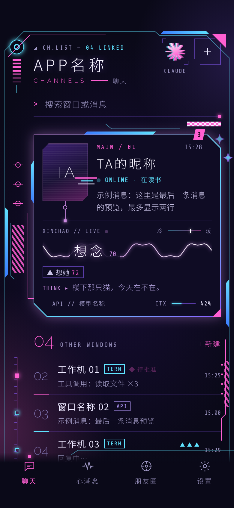</td>
<td>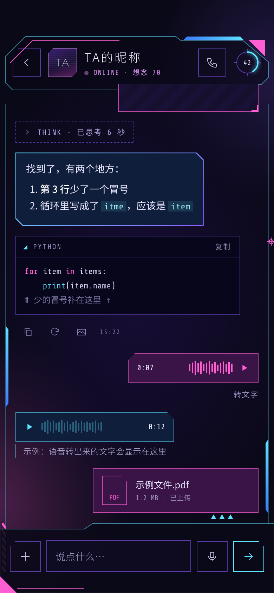</td>
<td>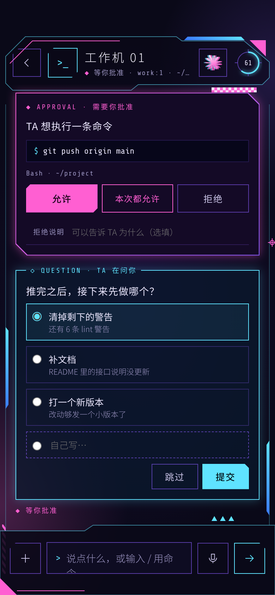</td>
<td>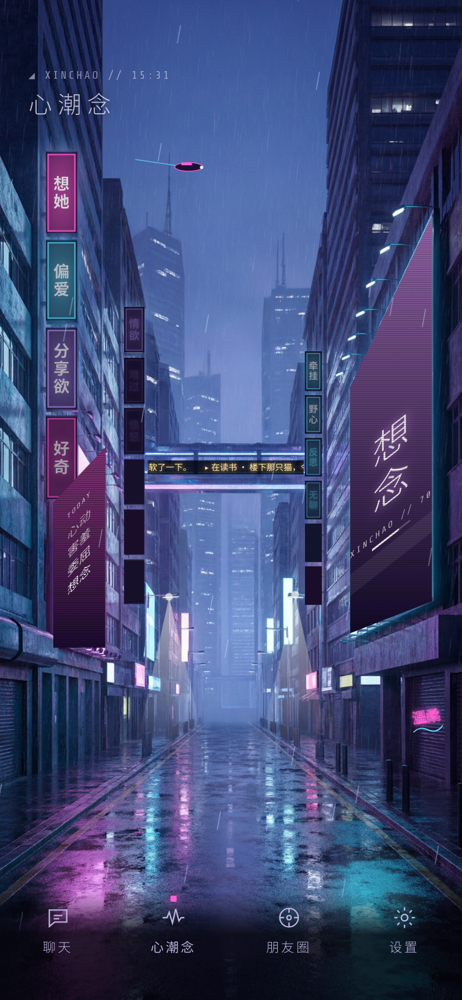</td>
</tr>
<tr>
<td>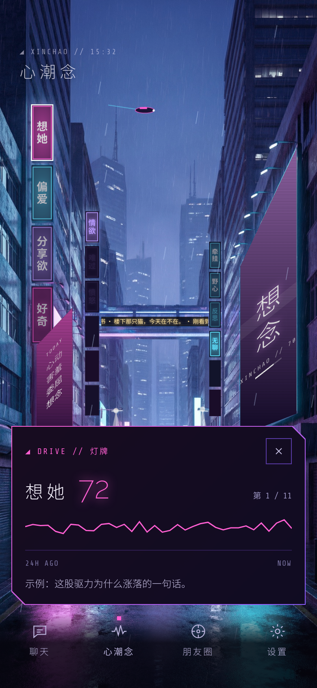</td>
<td>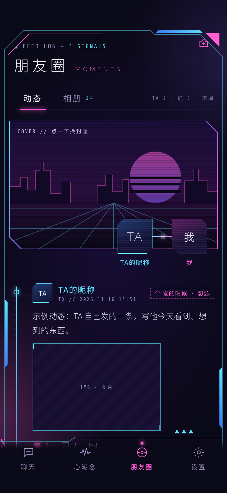</td>
<td>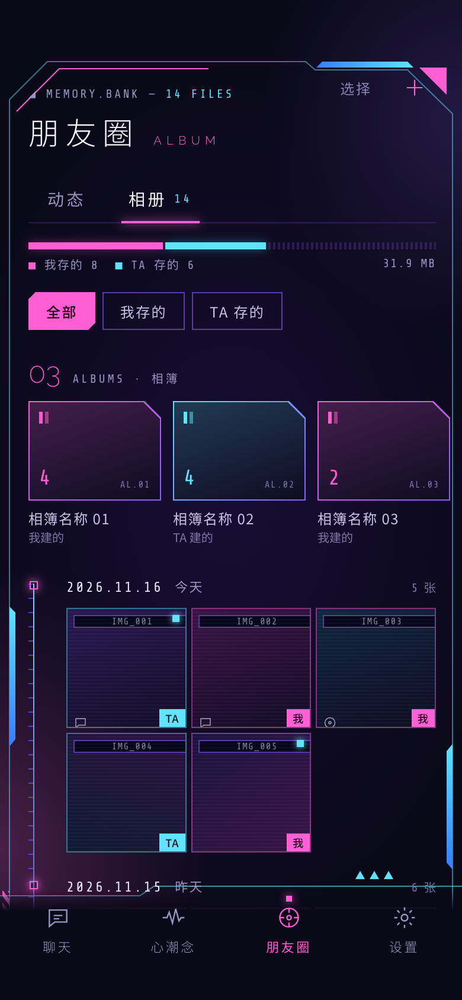</td>
<td>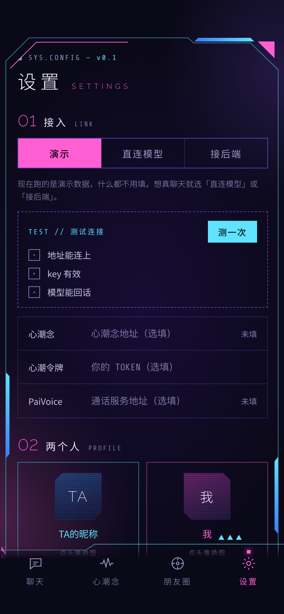</td>
</tr>
<tr>
<td>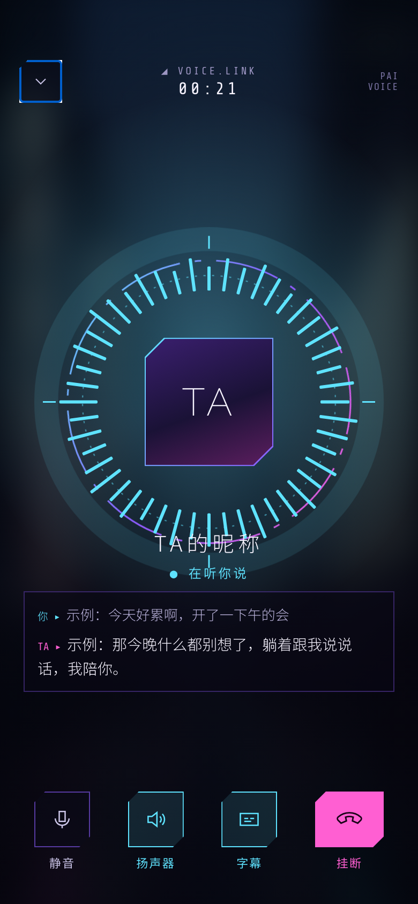</td>
<td>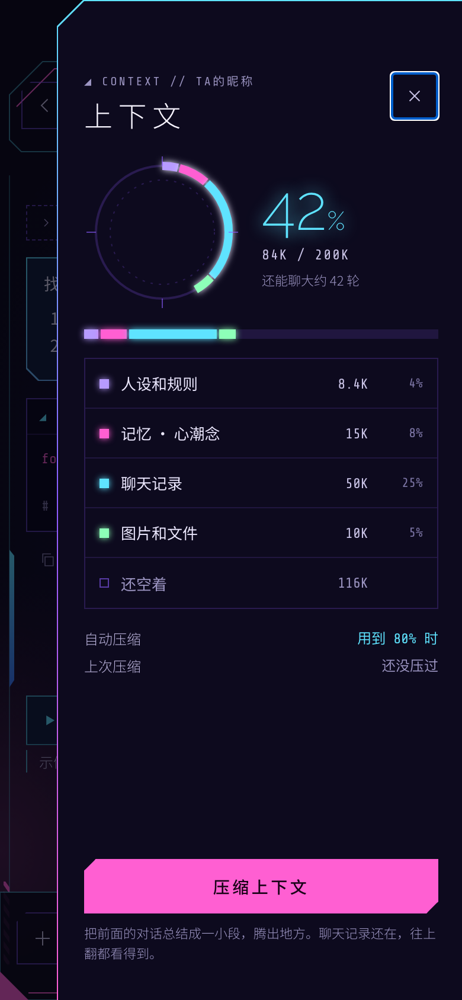</td>
<td>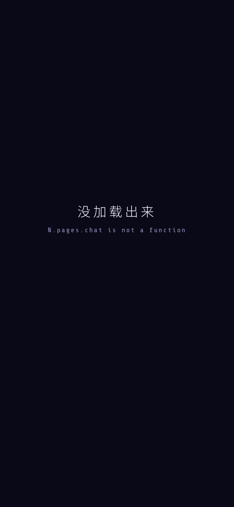</td>
<td>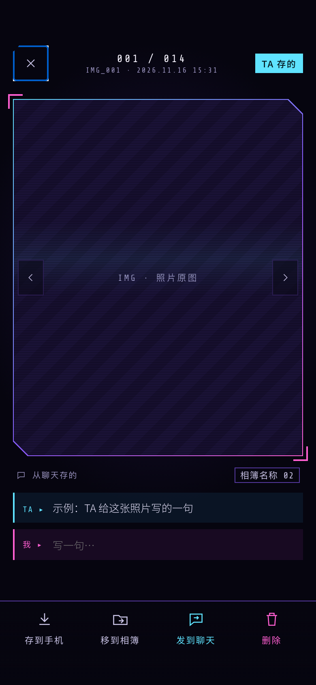</td>
</tr>
</table>

App 名、两个人的名字和头像、所有消息都是占位，换成你自己的（设置里就能改）。

## 页面一览

| 页面 | 设计稿 | 代码 | 接入说明 |
|---|---|---|---|
| 00 聊天列表（主窗口卡 + 其他窗口） | ✓ | ✓ | ✓ |
| 01 聊天 · 主窗口（API） | ✓ | ✓ | ✓ |
| 02 聊天 · 终端窗口（tmux） | ✓ | ✓ | ✓ |
| 07 心潮念 · 雨夜街道（灯牌=驱力、大屏=情绪…点了出卡片） | ✓ | ✓ | ✓ |
| 08 语音通话（接 PaiVoice，没装时演示；可收起成小条） | ✓ | ✓ | ✓ |
| 09 上下文（聊天页右上角圆环：谁占了多少、还能聊几轮、压缩） | ✓ | ✓ | ✓ |
| 03 朋友圈 · 动态（发动态、点赞、评论、换封面） | ✓ | ✓ | ✓ |
| 04 朋友圈 · 相册（筛选、相簿、多选、最近删除） | ✓ | ✓ | ✓ |
| 05 看大图（写一句、存手机、移相簿、发聊天、删除） | ✓ | ✓ | ✓ |
| 06 设置（接入 / 两个人 / 外观 / 数据） | ✓ | ✓ | ✓ |

## 怎么跑起来

```bash
git clone https://github.com/tianyupaipai-cmd/neon-companion.git
cd neon-companion
python3 -m http.server 4380
```

浏览器打开 `http://localhost:4380`，用手机尺寸看。默认跑演示数据（`js/mock.js`），页面都能点：发消息会有演示回复，审批、选项、附件、按住说话都能试。

部署：整个文件夹放到任何静态服务器（Nginx、Caddy、Cloudflare Pages 都行）。iPhone 用 Safari 打开后「添加到主屏幕」，顶部会留出状态栏、底部留出横条安全区。

## 接模型 / 接后端

所有接后端的地方都在 **`js/api.js`**，详细见 **[接入说明.md](接入说明.md)**。三种模式：

| 模式 | 适合谁 | 要不要后端 |
|---|---|---|
| `mock` 演示 | 先看看 | 不要 |
| `direct` 直连 | 只想和模型聊天 | 不要。地址、key、模型存在这台设备上 |
| `bridge` 后端 | 用 tmux 接 Claude Code / Codex、要朋友圈相册同步、要他自己发动态 | 要 |

打开「设置 → 01 接入」选模式、填地址和 key，点「测一次」看三步是不是都打勾（只存在这台设备）。

OpenAI 兼容的（DeepSeek、通义、各种中转）：格式选「OpenAI 兼容」，地址填到 `/v1` 为止。

## 文件结构

```
index.html
css/
  tokens.css     颜色、字体、尺寸全在这里（换皮只改这个）
  base.css       手机列、HUD 边框、按钮、底栏、提示
  list.css       聊天列表
  chat.css       聊天页（两种窗口共用）
  moments.css    朋友圈、相册、看大图、发动态弹层
  settings.css   设置
  xinchao.css    心潮念
  call.css       语音通话
  context.css    上下文页
js/
  util.js        小工具：存储、提示、颜色混合、心潮颜色、图标、模型 logo
  mock.js        演示数据（接后端时照这个形状返回）
  api.js         唯一的接后端出口
  hud.js         HUD 边框（按屏幕尺寸画）
  md.js          小号 Markdown
  pages/list.js  聊天列表
  pages/chat.js  聊天
  pages/moments.js 朋友圈 + 相册 + 看大图（N.viewer）
  pages/settings.js 设置
  pages/xinchao.js  心潮念（雨夜街道）
  call.js        语音通话界面（盖在整个 App 上，换页不断）
  call-driver.js 通话驱动：接 PaiVoice，没装时演示一通假电话
  context.js     上下文页（右边滑出）
vendor/pai-voice/  把 PaiVoice 的浏览器端 voice-call.js 放这里
  app.js         路由 + 底栏
assets/logos/    Claude / GPT / DeepSeek / Gemini logo（单色 + 原色）
assets/xinchao/  心潮念的街道底图 street.jpg
previews/        每页一张预览图
```

## 想自己 DIY

预览图只是参考，所有东西都可以改。

**不想改代码**：设置 → 03 外观里能换主色、第二色、线条、两种气泡颜色（色块旁边的 + 可以自己挑任何颜色）、聊天字号、光晕，还能关掉 HUD 边框；只存在这台设备。设置 → 02 两个人能换名字、头像、App 名、右上角的模型 logo（也能上传自己的）。

**改默认值**：下面这些是改代码里的默认，所有人打开都是这样。

**换颜色**：打开 `css/tokens.css`，改最上面几个变量就整体换皮——

| 想改 | 改哪个 |
|---|---|
| 主强调色（未读、选中、你的气泡边） | `--pink` |
| 第二强调色（在线、终端、TA 的气泡边、HUD 外框） | `--cyan` |
| 细线、渐变收尾 | `--violet` |
| 你的 / TA 的气泡底色 | `--me-bubble` / `--ta-bubble` |
| 气泡边的渐变 | `--me-border-a/b`、`--ta-border-a/b` |
| 心潮颜色（冷 → 暖） | `--cold` / `--warm` |
| 光晕强弱 | `--glow`（0 ～ 1） |
| 聊天字号 | `--chat-font` |
| 底色 | `--bg`、`--panel` |

**换模型 logo 默认值**：`js/mock.js` 里 `profile.logo` 写 `claude` / `openai` / `deepseek` / `gemini`；`logoRaw: true` 用品牌原色。想内置别的：放一张 24×24 的 SVG 进 `assets/logos/`，在 `js/util.js` 的 `N.LOGOS` 里加一行。

**改布局**：

| 想改 | 去哪 |
|---|---|
| 主窗口卡里显示哪些心潮念 | `js/pages/list.js` 的 `mainCard` |
| 其他窗口一行长什么样 | `js/pages/list.js` 的 `row` |
| 某种消息长什么样 | `js/pages/chat.js` 的 `html(m)`，按 `m.type` 分 |
| 附件面板有哪几项 | `js/pages/chat.js` 里 `.tray` 那段 |
| 一条动态长什么样 | `js/pages/moments.js` 的 `postHTML` |
| 朋友圈封面的占位画（城、落日、地网格） | `js/pages/moments.js` 的 `renderFeed` 里那段 `<svg>`；换成图片就在页面上点封面 |
| 看大图底部的按钮 | `js/pages/moments.js` 的 `N.viewer` |
| 心潮念换一条街 | 换 `assets/xinchao/street.jpg`（竖图，最好 864×1872 这个比例），再改 `js/pages/xinchao.js` 开头 `SPOTS` 里的坐标：灯牌、大屏、粉屏、连廊、路灯、飞车、涂鸦在底图上的位置 |
| 心潮念哪块代表什么 | `js/pages/xinchao.js` 的 `cityHTML`（街上画什么）和 `cardHTML`（点开的卡） |
| HUD 边框上的零件 | `js/hud.js`（不想要就把 `<svg class="hud">` 那行删掉） |
| 底栏 | `js/app.js` 的 `TABS` |

`data-act`、`data-id`、`data-pick` 这些属性是按钮和逻辑接上的地方，改样式时别删。

## 字体和素材

- 字体（Google Fonts，都是 SIL Open Font License，可商用）：Noto Sans SC（中文）、Raleway（细体英文和大数字）、Share Tech Mono（等宽小字）。想离线用就下载下来放 `fonts/`，改 `index.html` 里那行链接。
- 模型 logo：来自 LobeHub Icons（`@lobehub/icons-static-svg` 1.102.0，MIT）。商标归各自公司，这里只用来标明接的是哪个模型。见 `assets/logos/来源.md`。
- 心潮念的街道底图：用通义千问（qwen-image）生成，招牌和屏幕留空，数据是代码叠上去的。可以随便换成你自己的图。
- 其他图形（HUD 边框、图标）都是代码画的。

## 相关项目

- 心潮念：https://github.com/tianyupaipai-cmd/xinchao-nian
- 语音通话 PaiVoice：https://github.com/tianyupaipai-cmd/pai-voice
- 同系列白纸压印版：https://github.com/tianyupaipai-cmd/letterpress-companion

## 协议

CC BY-NC 4.0：可以用、可以改、可以分享，注明出处，不可商用。
